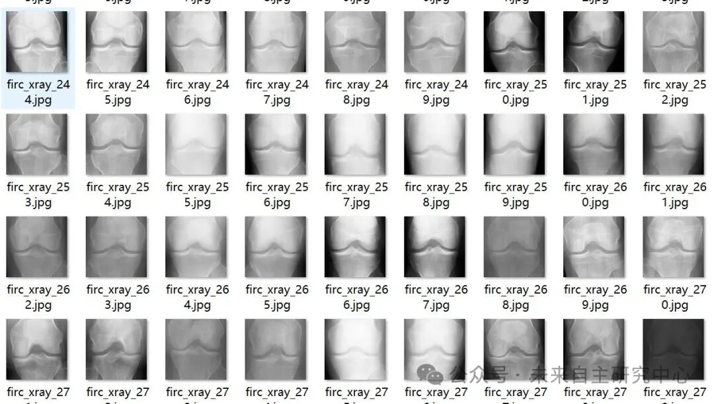
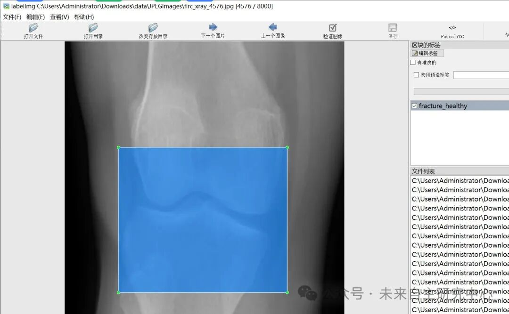

# Intelligent Medical X-ray Image Fracture Severity Detection Dataset VOC+YOLO format with 8000 images in 5 categories

Dataset format: Pascal VOC format + YOLO format (txt file without split path, only containing jpg images and corresponding VOC format xml files and yolo format txt files)

Number of images (number of jpg files): 8000

Number of annotations (number of xml files): 8000

Number of annotations (number of txt files): 8000

Label category count: 5

Label category names (note that the order of labels in the YOLO format does not correspond to this, but is based on the classes.txt file in the labels folder): ["fracture_doubtful", "fracture_healthy", "fracture_minimal", "fracture_moderate", "fracture_severe"]

Number of boxes labeled in each category:

fracture_doubtful frame count = 1414

fracture_healthy frame count = 3700

fracture_minimal frame count = 819

fracture_moderate box count = 730

fracture_severe frame count = 1337

Total frame count: 8000

Using labelImg:

Annotation rules: Draw a rectangle around the category.

Important Notice: No

Special : This dataset does not guarantee the accuracy or precision of the trained models or weight files. The dataset is provided with accurate and reasonable annotations only.

Image Preview:

Annotation example:

## Payment

Here is a pay link on Stripe ( https://buy.stripe.com/3cs8yP7sY87d0vu9AB ). Please contact me lonlonago@foxmail.com after funding $89, and I will send you a complete data files , thank you!

